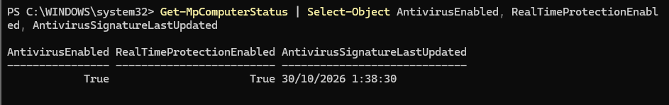
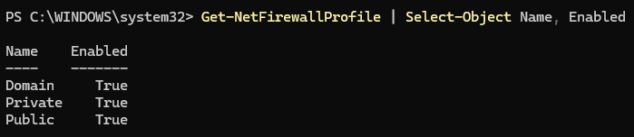
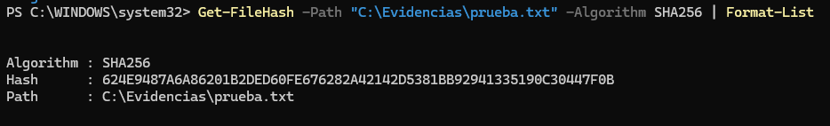
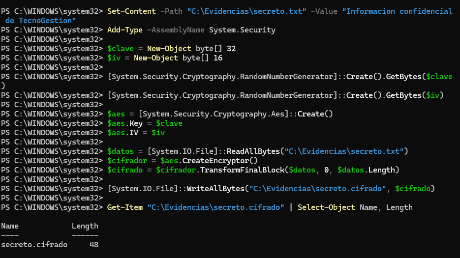

# 1. Prevención y concienciación

**Estado:** teoría resumida aprobada. Cartel gráfico, fuentes originales y pruebas prácticas pendientes.

## 1.1. Principales riesgos y amenazas

La empresa ficticia **TecnoGestión S. L.**, con 100 empleados, ha sufrido un ataque de phishing. Un trabajador abrió un archivo malicioso recibido por correo electrónico, provocando un incidente de seguridad.

Los principales riesgos son:

| Riesgo | Explicación |
|---|---|
| Phishing | Correos falsos para engañar a los trabajadores. |
| Malware | Programas maliciosos que pueden dañar equipos o robar información. |
| Ransomware | Malware que cifra archivos y puede exigir un rescate. |
| Robo de contraseñas | Permite acceder a cuentas sin autorización. |
| Fuga de datos | Posible robo de información de clientes. |
| Accesos no autorizados | Entrada a archivos o sistemas sin permiso. |

Para proteger la información debemos cumplir tres principios:

- **Confidencialidad:** solo acceden a los datos las personas autorizadas.
- **Integridad:** los datos no deben modificarse sin permiso.
- **Disponibilidad:** los sistemas y archivos deben estar accesibles cuando se necesiten.

### Cómo afecta cada amenaza a la empresa

El phishing es el punto de entrada del caso: el atacante se hace pasar por Recursos Humanos para que alguien confíe en el mensaje. Tras ejecutar el adjunto, el malware podría intentar robar contraseñas, conectarse a otros equipos o consultar archivos internos. Por eso debemos proteger tanto el correo como los ordenadores y las carpetas compartidas.

No todas las amenazas se han confirmado. En concreto, el ransomware y la fuga de datos son riesgos que tendremos en cuenta, no hechos demostrados.

**Ejemplo:** si una cuenta infectada tiene acceso a todos los documentos de clientes, el daño potencial será mayor que si solo puede consultar los archivos de su departamento.

## 1.2. Normas de seguridad para los trabajadores

Para evitar futuros ataques, la empresa establecerá las siguientes normas:

1. Utilizar contraseñas seguras y diferentes.
2. Activar la autenticación en dos pasos (MFA).
3. Mantener los ordenadores y programas actualizados.
4. No abrir correos, enlaces o archivos sospechosos.
5. Mantener el antivirus y el firewall activados.
6. Instalar únicamente programas autorizados.
7. Bloquear el ordenador al abandonar el puesto.
8. Acceder solo a los archivos necesarios para el trabajo.
9. Realizar copias de seguridad periódicas.
10. Avisar inmediatamente a informática ante cualquier actividad sospechosa.

Estas medidas ayudan a reducir los riesgos y limitar las consecuencias de un ataque.

### Cómo aplicaremos estas normas

La empresa comunicará las normas por escrito y las explicará durante la formación. Informática revisará que los equipos tengan las actualizaciones y la protección activadas; los responsables de departamento revisarán quién necesita acceso a cada carpeta.

**Ejemplo:** un empleado que recibe una supuesta nómina de Recursos Humanos no debería abrirla directamente. Primero comprobará la dirección del remitente y, si tiene dudas, preguntará a Recursos Humanos por otro canal conocido.

Las copias de seguridad deberán probarse periódicamente: no basta con crearlas si después no pueden recuperarse.

## 1.3. Plan de formación y concienciación

El objetivo es enseñar a los 100 empleados a reconocer amenazas y actuar correctamente.

| Elemento | Propuesta |
|---|---|
| Formación inicial | Una sesión de 1 hora. |
| Frecuencia | Refuerzo cada 6 meses. |
| Contenidos | Phishing, malware, contraseñas, MFA y protección de datos. |
| Actividades | Vídeos, ejemplos y simulaciones de phishing. |
| Evaluación | Cuestionarios para comprobar lo aprendido. |

También se realizarán simulaciones de correos fraudulentos, sin archivos peligrosos, para comprobar si los trabajadores identifican los ataques.

### Cómo comprobaremos si la formación funciona

Al comenzar se realizará un cuestionario breve para saber qué conocimientos tienen los trabajadores. Después de la sesión se repetirá la evaluación y se corregirán las preguntas más falladas. Una simulación segura de phishing permitirá practicar cómo identificar y comunicar correos sospechosos.

El objetivo no será castigar a quien se equivoque, sino detectar qué temas necesitan más explicación. Se registrará el número de trabajadores formados y los resultados globales, sin utilizar contraseñas reales ni adjuntos peligrosos.

## 1.4. Cartel sobre phishing y guía de buenas prácticas

### Cartel: ¡Cuidado con el phishing!

**Antes de abrir un correo:**

- Comprueba quién lo envía.
- Desconfía de los mensajes urgentes.
- No abras enlaces ni archivos sospechosos.
- Nunca compartas tus contraseñas.
- Si tienes dudas, avisa a informática.

### Guía de buenas prácticas

- Utilizar contraseñas fuertes y MFA.
- Mantener los equipos actualizados.
- No descargar archivos desconocidos.
- Utilizar software autorizado.
- Proteger los datos de clientes.
- Realizar copias de seguridad.
- Informar de cualquier incidente.

El cartel y la guía se distribuirán entre los empleados para mejorar la seguridad de la empresa.

### Cómo se utilizarán los materiales

El cartel se colocará cerca de los puestos de trabajo y se compartirá por los canales internos. La guía se entregará al incorporarse a la empresa y permanecerá disponible para consultas rápidas.

El mensaje principal será sencillo: **si un correo parece extraño, no abras el archivo y avisa a informática**. Avisar pronto permite investigar antes de que se extienda el problema.

## 1.5. Criptografía y seguridad

La criptografía permite proteger la información y realizar comunicaciones seguras.

| Concepto | Explicación | Ejemplo |
|---|---|---|
| **Cifrado simétrico** | Utiliza la misma clave para cifrar y descifrar. | AES |
| **Cifrado asimétrico** | Utiliza una clave pública y otra privada. | RSA |
| **Funciones hash** | Generan una huella digital para comprobar la integridad de archivos. | SHA-256 |
| **Certificados digitales** | Relacionan una identidad con una clave pública. | Certificado TLS |
| **Firmas electrónicas** | Permiten firmar documentos electrónicamente y, según el tipo, comprobar su autenticidad e integridad. | Firma digital |
| **PKI** | Infraestructura que gestiona certificados y claves públicas. | Autoridad de Certificación |
| **Diffie-Hellman** | Permite acordar una clave secreta compartida sin enviarla directamente. | ECDHE |

**Aplicación a nuestra empresa:** utilizaremos cifrado para proteger la información, certificados para verificar conexiones y funciones hash para comprobar que las evidencias de la investigación no han sido modificadas.

### Ejemplos de uso en nuestro incidente

- **AES:** puede proteger el contenido de un disco o archivo de la empresa si el dispositivo se pierde o lo roba alguien.
- **RSA y certificados:** ayudan a verificar identidades y realizar operaciones criptográficas en servicios seguros.
- **SHA-256:** permitirá obtener una huella del archivo investigado y comprobar si la copia conservada sigue siendo igual.
- **Firma digital y PKI:** permiten verificar documentos firmados dentro de un sistema de certificados confiable.
- **Diffie-Hellman:** puede ayudar a establecer claves para una conexión cifrada; por sí solo no autentica a la otra persona.

Es importante distinguir entre **cifrar** (ocultar contenido), **hacer un hash** (obtener una huella) y **firmar digitalmente** (ayudar a comprobar origen e integridad). No son la misma función.

## 1.6. Conclusión

El ataque sufrido por TecnoGestión S. L. demuestra la importancia de la prevención.

Para evitar incidentes similares, la empresa debe formar a sus empleados, establecer normas de seguridad, proteger los equipos y utilizar herramientas criptográficas.

Estas medidas reducirán el riesgo de nuevos ataques y mejorarán la protección de los datos de clientes.

---

## Evidencias prácticas realizadas en el laboratorio

Las siguientes pruebas se realizaron en máquinas de laboratorio. Las capturas documentan los resultados observados; **no demuestran que se ejecutara malware real ni confirman una fuga de datos**.

### Antivirus de Windows

**Herramienta o comando:** `Get-MpComputerStatus`.

**Resultado:** El antivirus y la protección en tiempo real estaban activos (True). Las firmas mostraban fecha 30/10/2026 y conviene comprobar su actualización.

*Evidencia: [P1_01_Antivirus.png](../evidencias/P1_01_Antivirus.png)*.

### Estado del firewall

**Herramienta o comando:** `Get-NetFirewallProfile`.

**Resultado:** Los perfiles Domain, Private y Public aparecieron habilitados.

*Evidencia: [P1_02_Firewall.png](../evidencias/P1_02_Firewall.png)*.

### Hash SHA-256 de un archivo

**Herramienta o comando:** `Get-FileHash`.

**Resultado:** Se obtuvo la huella SHA-256 de C:\Evidencias\prueba.txt para documentar su integridad inicial.

*Evidencia: [P1_03_SHA256.png](../evidencias/P1_03_SHA256.png)*.

### Demostración de cifrado AES

**Herramienta o comando:** `PowerShell y .NET AES`.

**Resultado:** Se creó el archivo secreto.cifrado de 48 bytes usando AES con clave de 256 bits. No se documentó el descifrado.

*Evidencia: [P1_04_Cifrado.png](../evidencias/P1_04_Cifrado.png)*.

## Pendiente para la entrega definitiva

- Verificar y completar las fuentes de los apuntes del profesor.
- Revisar el alcance de cada prueba frente al enunciado.
