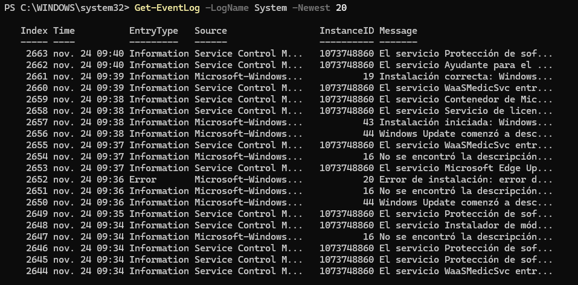
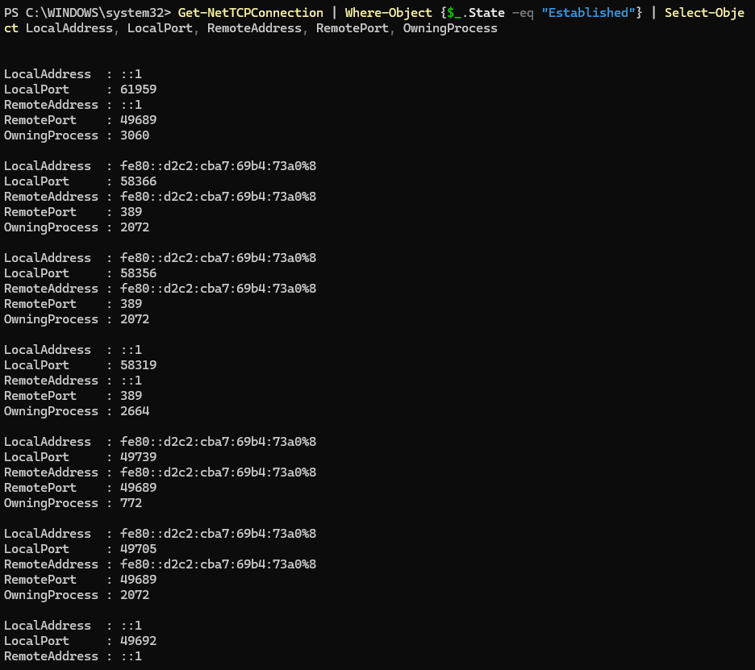
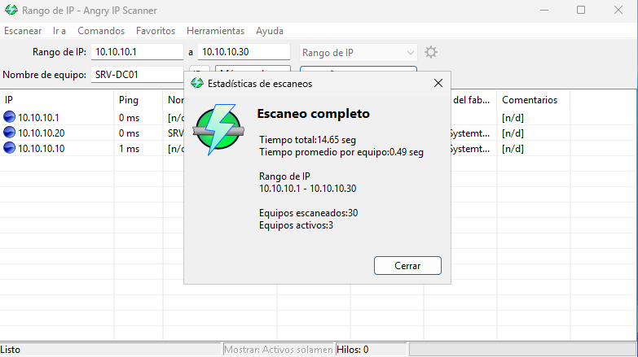
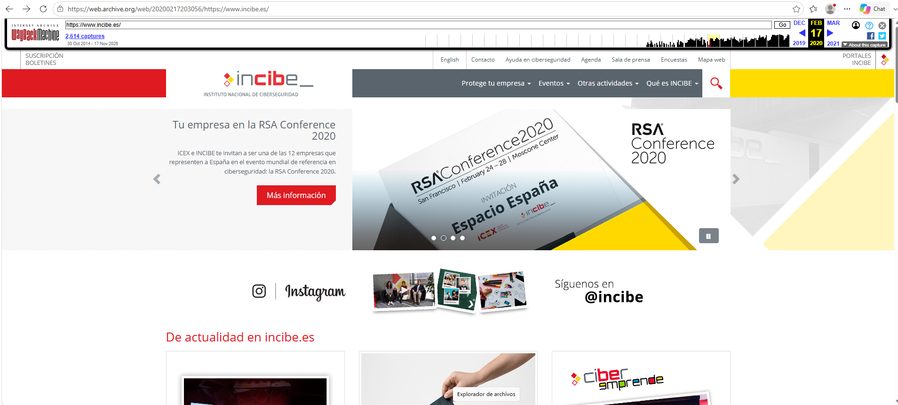

# 2. DETECCIÓN Y AUDITORÍA

**Estado:** teoría resumida aprobada; prácticas, evidencias y fuentes pendientes.

## 2.1. Clasificación del incidente y gravedad

La empresa TecnoGestión S. L. ha sufrido un ataque de phishing. Un trabajador abrió un archivo malicioso recibido por correo electrónico.

Después se detectaron conexiones sospechosas, alertas del antivirus e intentos de acceso a carpetas compartidas.

**Clasificación del incidente:**

| Tipo | Descripción |
|---|---|
| Phishing | Correo falso que suplanta a Recursos Humanos. |
| Malware | Ejecución de un archivo malicioso. |
| Acceso no autorizado | Intentos de acceder a carpetas compartidas. |
| Posible fuga de datos | Sospecha de extracción de información de clientes. |

**Gravedad propuesta: Alta**, porque pueden estar comprometidos los equipos y los datos de la empresa.

La gravedad definitiva dependerá de los resultados de la investigación.

### Por qué la gravedad inicial es alta

El problema no se limita a un correo extraño: el archivo llegó a ejecutarse y después aparecieron alertas y conexiones sospechosas. Además, hay indicios de intentos de acceso a archivos compartidos y una posible exposición de datos personales.

La prioridad es averiguar si el malware sigue activo, si otras cuentas han sido utilizadas y si hubo extracción real de información. La clasificación se actualizará cuando tengamos evidencias.

## 2.2. Sistemas y servicios afectados

Los principales sistemas que podrían estar afectados son:

- **Ordenadores:** equipo del empleado que ejecutó el archivo malicioso y posibles equipos adicionales.
- **Correo electrónico:** utilizado para distribuir el phishing.
- **Servidor de archivos:** posibles intentos de acceso a carpetas compartidas.
- **Red empresarial:** conexiones sospechosas con IP externas.
- **Base de datos:** posible exposición de información de clientes.

Todavía debemos investigar qué sistemas están realmente comprometidos.

### Orden de revisión de los sistemas

Primero analizaremos el ordenador del empleado que abrió el adjunto. Después comprobaremos su cuenta de correo, las conexiones que realizó y si se intentó acceder al servidor de archivos.

También revisaremos otros equipos relacionados con las mismas alertas. La base de datos de clientes será prioritaria por el posible impacto sobre la información personal, pero **no afirmaremos que esté afectada sin pruebas**.

## 2.3. Herramientas de detección y monitorización

Utilizaremos diferentes herramientas para investigar el incidente.

| Herramienta | Utilidad |
|---|---|
| Windows Defender | Detectar archivos y programas maliciosos. |
| Visor de eventos | Consultar los registros de Windows. |
| PowerShell | Revisar procesos, conexiones y servicios. |
| Wireshark | Analizar el tráfico de red. |
| Firewall | Revisar y controlar conexiones. |
| VirusTotal | Consultar información de archivos, IP y dominios sospechosos. |

También existen sistemas SIEM, IDS, IPS y EDR que permiten detectar y supervisar amenazas en una empresa.

### Para qué sirve cada tipo de herramienta

**Defender** puede mostrar detecciones o archivos puestos en cuarentena. **PowerShell** nos permite consultar información del propio equipo. **Wireshark** ayuda a observar paquetes de red capturados de forma autorizada.

En una empresa grande podrían usarse herramientas más completas: un **SIEM** reúne registros de varios sistemas, un **IDS** alerta sobre actividad sospechosa, un **IPS** puede bloquearla y un **EDR** ayuda a investigar y responder desde los equipos.

Para nuestro laboratorio comenzaremos con las herramientas de Windows que ya hemos estudiado, antes de añadir programas más complejos.

## 2.4. Registros que debemos consultar

Para saber qué ha ocurrido, revisaremos los siguientes registros:

| Registro | Qué buscamos |
|---|---|
| Antivirus | Alertas y detecciones de malware. |
| Firewall | Conexiones permitidas o bloqueadas. |
| Windows | Inicios de sesión, errores y ejecución de procesos, si están registrados. |
| Red | Conexiones con direcciones IP desconocidas. |
| Correo | Remitente, destinatarios, enlaces y archivos adjuntos. |

Estos registros nos ayudarán a reconstruir el incidente y conocer qué actividad se ha producido.

### Qué preguntas responderemos con los registros

Queremos saber **qué ocurrió, cuándo ocurrió y desde qué equipo**. Compararemos la hora del correo con la ejecución del archivo, las alertas del antivirus y las conexiones detectadas.

Un registro aislado no demuestra necesariamente un ataque. Por ejemplo, conectarse a una IP externa es normal en muchos programas. Será sospechoso si coincide con otros indicios, como un proceso desconocido o una detección del antivirus.

## 2.5. Investigación mediante OSINT

OSINT consiste en recopilar información utilizando fuentes públicas.

En nuestro incidente investigaremos las direcciones IP y los dominios sospechosos para comprobar si están relacionados con actividades maliciosas.

**Herramientas propuestas:**

- **VirusTotal:** consultar informes sobre archivos, IP y dominios.
- **Shodan:** obtener información pública sobre sistemas y servicios expuestos.
- **WHOIS/RDAP:** consultar datos públicos de registro de dominios.
- **AbuseIPDB:** consultar reportes de actividad sospechosa asociados a direcciones IP.

Los resultados de estas páginas son indicios y deben comprobarse con otras evidencias.

### Procedimiento de consulta

Cuando encontremos una IP o un dominio de interés, anotaremos el indicador y consultaremos distintas fuentes públicas. Revisaremos si existen reportes anteriores y guardaremos fecha, enlace y resultado.

**Precaución:** no subiremos documentos privados ni archivos internos a servicios públicos de análisis. Tampoco consideraremos una IP maliciosa únicamente porque aparezca reportada una vez; los resultados deben contrastarse.

## 2.6. Ficha de registro del incidente

Para documentar correctamente el incidente, crearemos una ficha con la información conocida.

| Campo | Información |
|---|---|
| Identificador | INC-2026-001 |
| Empresa | TecnoGestión S. L. |
| Tipo de ataque | Phishing con ejecución de malware |
| Gravedad inicial | Alta (provisional) |
| Origen aparente | Correo falso de Recursos Humanos |
| Equipo afectado | Ordenador de un empleado |
| Actividad detectada | Conexiones externas y accesos sospechosos |
| Posible consecuencia | Exposición de datos de clientes |
| Estado | Pendiente de investigación y confirmación |

La fecha, las direcciones IP y las evidencias obtenidas se añadirán cuando realicemos las pruebas prácticas.

### Cómo actualizaremos la ficha

A medida que investiguemos añadiremos la fecha de detección, responsables, equipos analizados, indicadores encontrados, decisiones adoptadas y evidencias asociadas.

Se distinguirá entre **hechos observados** (por ejemplo, una alerta registrada), **indicios** (una conexión potencialmente sospechosa) y **datos sin confirmar** (una posible fuga). Esto ayudará a justificar las decisiones del siguiente apartado.

## 2.7. Conclusión

La detección y la auditoría permiten identificar actividades sospechosas y conocer el alcance de un incidente.

En TecnoGestión S. L. utilizaremos el antivirus, los registros de Windows, PowerShell y herramientas de análisis de red para investigar lo ocurrido.

Toda la información obtenida servirá para continuar con el apartado 3: Investigación y análisis.

---

## Evidencias prácticas realizadas en el laboratorio

Las siguientes pruebas se realizaron en máquinas de laboratorio. Las capturas documentan los resultados observados; **no demuestran que se ejecutara malware real ni confirman una fuga de datos**.

### Registros de Windows

**Herramienta o comando:** `Get-EventLog -LogName System -Newest 20`.

**Resultado:** Se consultaron 20 eventos del sistema; se observaron eventos de servicios y errores de instalación. No prueban un ataque.

*Evidencia: [P2_01_EventosWindows.png](../evidencias/P2_01_EventosWindows.png)*.

### Conexiones TCP del equipo

**Herramienta o comando:** `Get-NetTCPConnection`.

**Resultado:** Se mostraron conexiones establecidas con puertos y procesos; en la captura solo se aprecian direcciones locales y de enlace local.

*Evidencia: [P2_02_Conexiones.png](../evidencias/P2_02_Conexiones.png)*.

### OSINT con Shodan

**Herramienta o comando:** `Shodan: 1.1.1.1`.

**Resultado:** Se consultaron puertos y metadatos públicos de una IP conocida, sin relación demostrada con el incidente ficticio.

*Evidencia: [P2_03_Shodan.png](../evidencias/P2_03_Shodan.png)*.

### Descubrimiento de equipos

**Herramienta o comando:** `Angry IP Scanner`.

**Resultado:** En la red de laboratorio 10.10.10.1–10.10.10.30 se comprobaron 30 IP y se encontraron 3 activas: 10.10.10.1, 10.10.10.10 y 10.10.10.20.

*Evidencia: [P2_04_AngryIPScanner.png](../evidencias/P2_04_AngryIPScanner.png)*.

### Consulta de una web archivada

**Herramienta o comando:** `Wayback Machine`.

**Resultado:** Se visualizó una copia histórica de incibe.es fechada el 17/02/2020. Es una práctica de búsqueda histórica.

*Evidencia: [P2_05_WaybackMachine.png](../evidencias/P2_05_WaybackMachine.png)*.

## Pendiente para la entrega definitiva

- Verificar y completar las fuentes de los apuntes del profesor.
- Revisar el alcance de cada prueba frente al enunciado.
