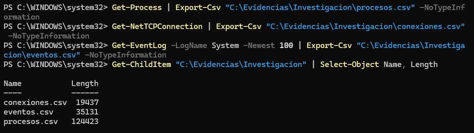
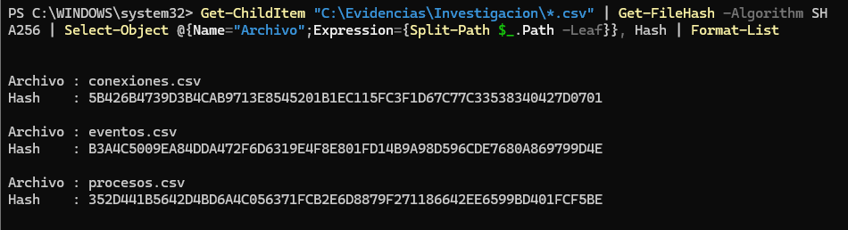
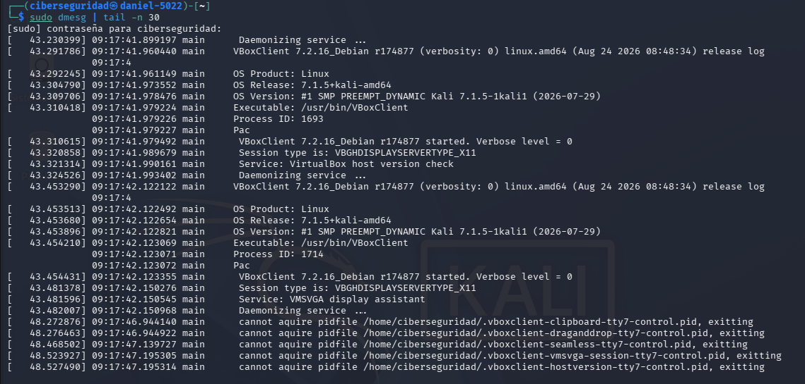

# 3. INVESTIGACIÓN Y ANÁLISIS

**Estado:** teoría resumida aprobada. Prácticas, evidencias y fuentes pendientes.

## 3.1. Recopilación de evidencias

El objetivo es investigar cómo se produjo el ataque, qué sistemas están afectados y si se han robado datos.

Para ello, recopilaremos las siguientes evidencias:

| Evidencia | Qué investigaremos |
|---|---|
| Correo electrónico | Remitente, enlaces y archivo adjunto. |
| Archivo malicioso | Nombre, tipo y comportamiento sospechoso. |
| Registros de Windows | Inicios de sesión, errores y actividad del sistema. |
| Procesos | Programas que se están ejecutando. |
| Conexiones de red | IP y puertos utilizados. |
| Antivirus | Alertas y amenazas detectadas. |
| Carpetas compartidas | Posibles accesos no autorizados. |

Utilizaremos principalmente **PowerShell y el Visor de eventos de Windows** para obtener información.

### Prioridad de recogida

Empezaremos por la información que puede desaparecer rápidamente, como procesos y conexiones activas, siempre que se pueda recopilar sin alterar innecesariamente el equipo. Después guardaremos registros, mensajes, archivos y copias de interés.

Cada evidencia tendrá un nombre claro, como `EV-01-correo` o `EV-02-registros`, y explicaremos de qué equipo procede. Las pruebas reales se recogerán en una máquina virtual autorizada, sin ejecutar malware.

## 3.2. Preservación de las evidencias

Es importante conservar las pruebas sin modificarlas para que puedan utilizarse durante la investigación.

Para ello seguiremos estas medidas:

1. Registrar la fecha, hora y origen de cada evidencia.
2. Guardar copias en una ubicación segura.
3. Evitar modificar los archivos originales.
4. Calcular el hash SHA-256 para comprobar su integridad.
5. Permitir el acceso únicamente a las personas autorizadas.

### Cómo evitaremos alterar las pruebas

Trabajaremos sobre copias cuando sea posible, conservando el original protegido. Anotaremos las herramientas utilizadas y los comandos ejecutados. No abriremos un adjunto peligroso haciendo doble clic para «ver qué pasa».

Cuando tomemos una captura, indicaremos qué demuestra y a qué evidencia corresponde. Además, calcularemos un hash de los archivos guardados para detectar modificaciones posteriores.

## 3.3. Investigación del correo y archivo malicioso

El ataque comenzó cuando un empleado recibió un correo falso de Recursos Humanos y ejecutó un archivo adjunto.

Investigaremos:

- **Remitente:** comprobar si la dirección es legítima.
- **Asunto:** identificar mensajes engañosos o urgentes.
- **Enlaces:** revisar si llevan a páginas sospechosas.
- **Adjunto:** analizar el nombre, extensión y hash del archivo.
- **Antivirus:** consultar si detectó alguna amenaza.

El archivo se analizará de forma segura, sin ejecutar malware real en nuestros equipos.

### Qué intentaremos descubrir

Comprobaremos si el nombre visible del remitente coincide con su dirección real y si el mensaje contiene peticiones extrañas. También estudiaremos la extensión del archivo, sus propiedades y las alertas asociadas a él.

**Ejemplo:** que el mensaje diga «Recursos Humanos» no demuestra que sea auténtico. La dirección real del remitente, las cabeceras y el contexto nos ayudarán a valorarlo. Los enlaces y adjuntos se estudiarán sin acceder a recursos peligrosos desde un equipo de trabajo.

## 3.4. Análisis de conexiones sospechosas

El departamento de informática ha detectado conexiones con direcciones IP externas.

Para investigarlas, utilizaremos PowerShell y herramientas de análisis de red.

Comprobaremos:

- Direcciones IP de destino.
- Puertos utilizados.
- Procesos relacionados con las conexiones.
- Fechas y horas de la actividad.
- Posibles conexiones con servidores maliciosos.

También podremos utilizar VirusTotal o AbuseIPDB para consultar información pública sobre las IP sospechosas.

### Relación entre procesos y conexiones

No basta con encontrar una dirección IP: también debemos identificar qué proceso se comunicó con ella y si la conexión corresponde a un servicio legítimo.

Intentaremos construir una pequeña línea temporal con la hora del correo, la ejecución del adjunto, la primera alerta y las conexiones posteriores. Así podremos comprobar si los hechos están relacionados o son coincidencias.

## 3.5. Cadena de custodia

La cadena de custodia es el registro que permite saber **quién ha recogido, utilizado o trasladado una evidencia, cuándo lo ha hecho y cómo se ha protegido**.

Para documentarla utilizaremos una tabla:

| Campo | Información que registraremos |
|---|---|
| Identificador | Código de la evidencia. |
| Descripción | Archivo, registro o captura. |
| Fecha y hora | Momento de la recogida. |
| Responsable | Persona que recoge la evidencia. |
| Hash SHA-256 | Huella digital del archivo. |
| Ubicación | Lugar donde se almacena. |
| Transferencias | Quién recibe la evidencia y cuándo. |

De esta forma podremos demostrar que las pruebas se han conservado correctamente.

### Ejemplo de registro de movimientos

Si el responsable recoge un registro y entrega una copia al técnico que lo analizará, anotaremos **quién lo recogió, a quién se entregó, a qué hora, por qué motivo y dónde quedó almacenado**.

La cadena de custodia no es solo una tabla: es un historial continuo de la evidencia desde que se obtiene hasta que se archiva. Así podremos explicar qué se hizo con cada archivo.

## 3.6. Cálculo del hash SHA-256

El **SHA-256** es una función hash que genera una huella digital de un archivo.

Permite comprobar si el contenido ha cambiado durante la investigación.

Para calcularlo utilizaremos PowerShell:

```powershell
Get-FileHash -Path "C:\Evidencias\archivo.txt" -Algorithm SHA256
```

El comando mostrará el hash SHA-256 del archivo seleccionado.

Volveremos a calcularlo posteriormente. Si ambos resultados coinciden, podremos comprobar que el contenido no ha cambiado.

El resultado real y su captura se añadirán cuando realicemos la práctica.

### Qué debe aparecer en la captura de la práctica

Para que el resultado sea comprensible, guardaremos una captura donde se vea el comando ejecutado, el nombre del archivo y el valor SHA-256. Después calcularemos de nuevo su hash y compararemos ambos resultados.

Si los hashes coinciden, es un indicio fuerte de que el contenido permanece igual. Sin embargo, el hash por sí solo no demuestra quién creó el archivo ni si es seguro.

El comando anterior es un **ejemplo**: la ruta se cambiará por la ubicación real del archivo de prueba cuando hagamos la práctica.

## 3.7. Conclusión

La investigación permite conocer cómo comenzó el ataque, qué equipos pueden estar afectados y qué actividad sospechosa se ha producido.

Mediante PowerShell, los registros de Windows y el análisis de evidencias podremos investigar el incidente de Daniel Company

También utilizaremos hashes SHA-256 y una cadena de custodia para proteger las pruebas obtenidas.

---

**Prácticas pendientes:** recopilación de evidencias con PowerShell, análisis de registros, cálculo de SHA-256 y documentación de la cadena de custodia.

## Evidencias prácticas realizadas en el laboratorio

Las siguientes pruebas se realizaron en máquinas de laboratorio. Las capturas documentan los resultados observados; **no demuestran que se ejecutara malware real ni confirman una fuga de datos**.

### Recopilación de registros

**Herramienta o comando:** `PowerShell y Export-Csv`.

**Resultado:** Se guardaron procesos.csv, conexiones.csv y eventos.csv a partir del equipo de laboratorio.



*Evidencia: [P3_01_Recopilacion.png](../evidencias/P3_01_Recopilacion.png)*.

### Hashes de las evidencias

**Herramienta o comando:** `Get-FileHash -Algorithm SHA256`.

**Resultado:** Se calcularon hashes SHA-256 de los tres CSV para comprobar posteriormente si cambian.



*Evidencia: [P3_02_HashEvidencias.png](../evidencias/P3_02_HashEvidencias.png)*.

### Registro inicial de cadena de custodia

**Herramienta o comando:** `Export-Csv e Import-Csv`.

**Resultado:** Se generó un registro con archivo, fecha y responsable. No sustituye el historial completo de transferencias de evidencias.


*Evidencia: [P3_03_CadenaCustodia.png](../evidencias/P3_03_CadenaCustodia.png)*.

### Mensajes del kernel de Kali Linux

**Herramienta o comando:** `sudo dmesg | tail -n 30`.

**Resultado:** Se observaron mensajes de VirtualBox y avisos de VBoxClient, que no demuestran una infección.



*Evidencia: [P3_04_EventosLinux.png](../evidencias/P3_04_EventosLinux.png)*.

### Registro de paquetes en Linux

**Herramienta o comando:** `cat /var/log/dpkg.log.1 | tail -n 25`.

**Resultado:** Se consultaron entradas sobre paquetes como kali-menu, cloudflared y ca-certificates-java.


*Evidencia: [P3_05_DpkgLinux.png](../evidencias/P3_05_DpkgLinux.png)*.

### Búsqueda de archivos en PowerShell ISE

**Herramienta o comando:** `dir *txt`.

**Resultado:** Se encontraron los archivos de prueba documento_original.txt, prueba.txt y secreto.txt.


*Evidencia: [P3_06_ListadoArchivos.png](../evidencias/P3_06_ListadoArchivos.png)*.

### Automatización de recopilación en PowerShell ISE

**Herramienta o comando:** `AnalisisForense.ps1`.

**Resultado:** El script generó procesos.csv, conexiones.csv y eventos.csv; en la captura aparecen el código y los archivos producidos.


*Evidencia: [P3_07_ScriptForenseISE.png](../evidencias/P3_07_ScriptForenseISE.png)*.


## Pendiente para la entrega definitiva

- Verificar y completar las fuentes de los apuntes del profesor.
- Revisar el alcance de cada prueba frente al enunciado.
