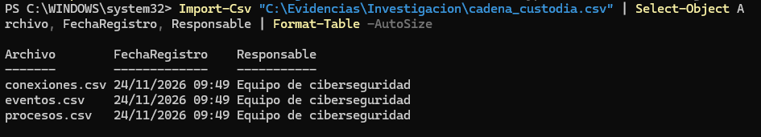
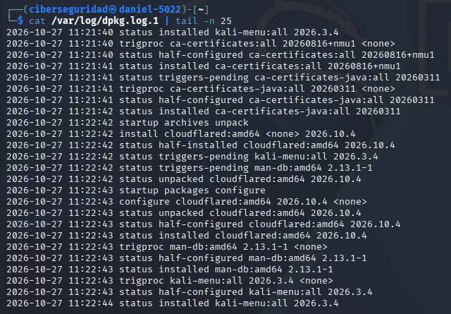
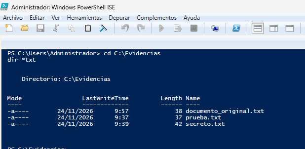
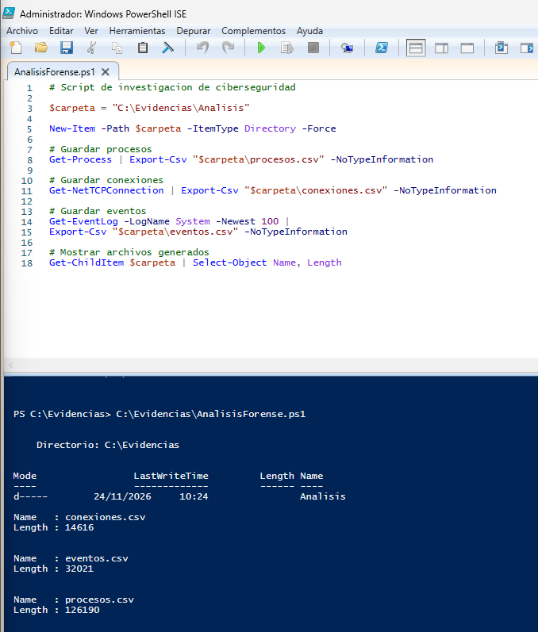
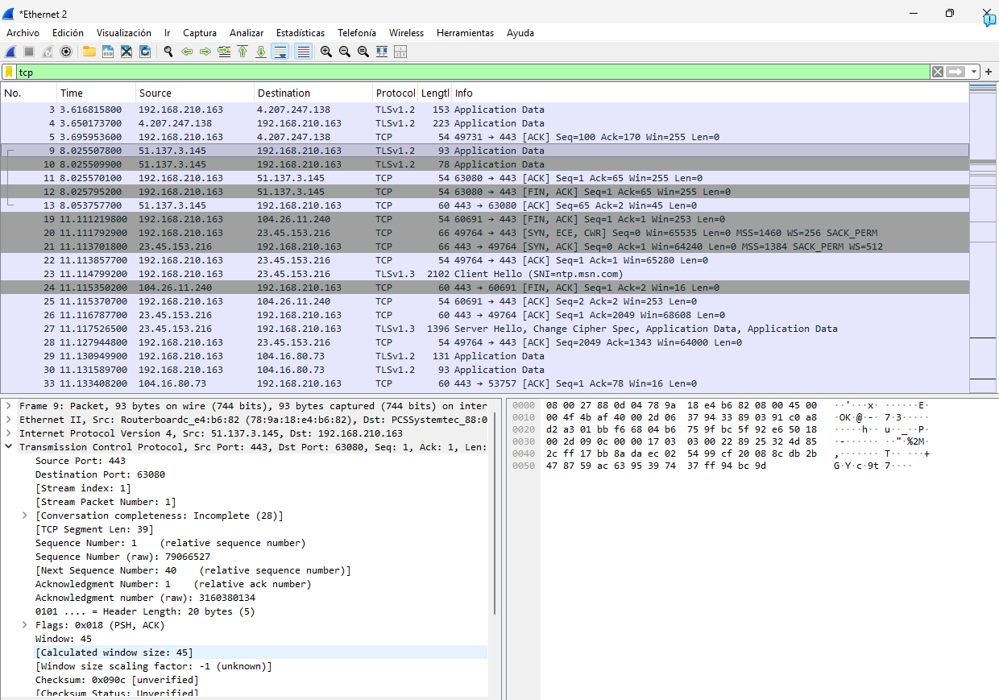
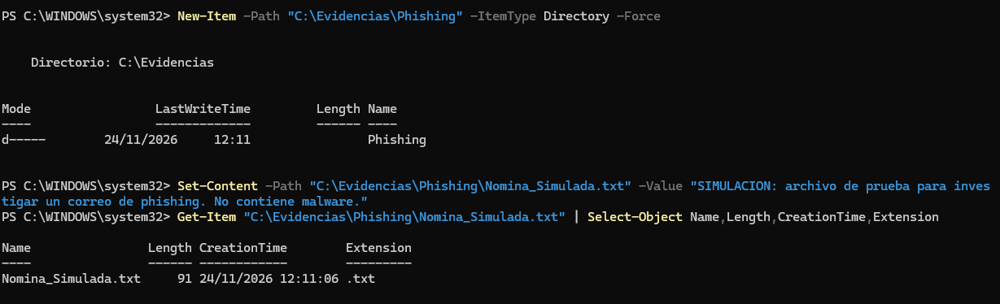
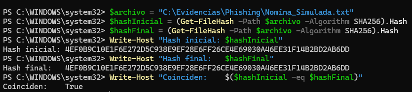
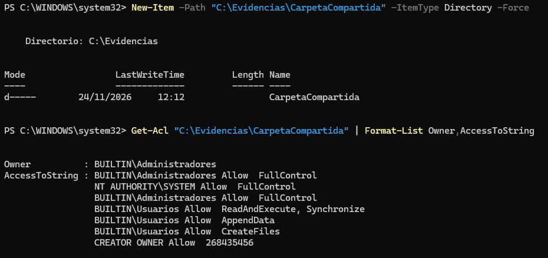

# 3. INVESTIGACIÓN Y ANÁLISIS

**Estado:** teoría, siete capturas y análisis documental del correo completados; sin análisis de malware real.

## 3.1. Recopilación de evidencias

El objetivo es investigar cómo se produjo el ataque, qué sistemas están afectados y si se han robado datos.

Para ello, recopilaremos las siguientes evidencias:

| Evidencia | Qué investigaremos |
|---|---|
| Correo electrónico | Remitente, enlaces y archivo adjunto. |
| Archivo malicioso | Nombre, tipo y comportamiento sospechoso. |
| Registros de Windows | Inicios de sesión, errores y actividad del sistema. |
| Procesos | Programas que se están ejecutando. |
| Conexiones de red | IP y puertos utilizados. |
| Antivirus | Alertas y amenazas detectadas. |
| Carpetas compartidas | Posibles accesos no autorizados. |

Utilizaremos principalmente **PowerShell y el Visor de eventos de Windows** para obtener información.

### Prioridad de recogida

Empezaremos por la información que puede desaparecer rápidamente, como procesos y conexiones activas, siempre que se pueda recopilar sin alterar innecesariamente el equipo. Después guardaremos registros, mensajes, archivos y copias de interés.

Cada evidencia tendrá un nombre claro, como `EV-01-correo` o `EV-02-registros`, y explicaremos de qué equipo procede. Las pruebas reales se recogerán en una máquina virtual autorizada, sin ejecutar malware.

## 3.2. Preservación de las evidencias

Es importante conservar las pruebas sin modificarlas para que puedan utilizarse durante la investigación.

Para ello seguiremos estas medidas:

1. Registrar la fecha, hora y origen de cada evidencia.
2. Guardar copias en una ubicación segura.
3. Evitar modificar los archivos originales.
4. Calcular el hash SHA-256 para comprobar su integridad.
5. Permitir el acceso únicamente a las personas autorizadas.

### Cómo evitaremos alterar las pruebas

Trabajaremos sobre copias cuando sea posible, conservando el original protegido. Anotaremos las herramientas utilizadas y los comandos ejecutados. No abriremos un adjunto peligroso haciendo doble clic para «ver qué pasa».

Cuando tomemos una captura, indicaremos qué demuestra y a qué evidencia corresponde. Además, calcularemos un hash de los archivos guardados para detectar modificaciones posteriores.

## 3.3. Investigación del correo y archivo malicioso

El ataque comenzó cuando un empleado recibió un correo falso de Recursos Humanos y ejecutó un archivo adjunto.

Investigaremos:

- **Remitente:** comprobar si la dirección es legítima.
- **Asunto:** identificar mensajes engañosos o urgentes.
- **Enlaces:** revisar si llevan a páginas sospechosas.
- **Adjunto:** analizar el nombre, extensión y hash del archivo.
- **Antivirus:** consultar si detectó alguna amenaza.

El archivo se analizará de forma segura, sin ejecutar malware real en nuestros equipos.

### Qué intentaremos descubrir

Comprobaremos si el nombre visible del remitente coincide con su dirección real y si el mensaje contiene peticiones extrañas. También estudiaremos la extensión del archivo, sus propiedades y las alertas asociadas a él.

**Ejemplo:** que el mensaje diga «Recursos Humanos» no demuestra que sea auténtico. La dirección real del remitente, las cabeceras y el contexto nos ayudarán a valorarlo. Los enlaces y adjuntos se estudiarán sin acceder a recursos peligrosos desde un equipo de trabajo.

## 3.4. Análisis de conexiones sospechosas

El departamento de informática ha detectado conexiones con direcciones IP externas.

Para investigarlas, utilizaremos PowerShell y herramientas de análisis de red.

Comprobaremos:

- Direcciones IP de destino.
- Puertos utilizados.
- Procesos relacionados con las conexiones.
- Fechas y horas de la actividad.
- Posibles conexiones con servidores maliciosos.

También podremos utilizar VirusTotal o AbuseIPDB para consultar información pública sobre las IP sospechosas.

### Relación entre procesos y conexiones

No basta con encontrar una dirección IP: también debemos identificar qué proceso se comunicó con ella y si la conexión corresponde a un servicio legítimo.

Intentaremos construir una pequeña línea temporal con la hora del correo, la ejecución del adjunto, la primera alerta y las conexiones posteriores. Así podremos comprobar si los hechos están relacionados o son coincidencias.

## 3.5. Cadena de custodia

La cadena de custodia es el registro que permite saber **quién ha recogido, utilizado o trasladado una evidencia, cuándo lo ha hecho y cómo se ha protegido**.

Para documentarla utilizaremos una tabla:

| Campo | Información que registraremos |
|---|---|
| Identificador | Código de la evidencia. |
| Descripción | Archivo, registro o captura. |
| Fecha y hora | Momento de la recogida. |
| Responsable | Persona que recoge la evidencia. |
| Hash SHA-256 | Huella digital del archivo. |
| Ubicación | Lugar donde se almacena. |
| Transferencias | Quién recibe la evidencia y cuándo. |

De esta forma podremos demostrar que las pruebas se han conservado correctamente.

### Ejemplo de registro de movimientos

Si el responsable recoge un registro y entrega una copia al técnico que lo analizará, anotaremos **quién lo recogió, a quién se entregó, a qué hora, por qué motivo y dónde quedó almacenado**.

La cadena de custodia no es solo una tabla: es un historial continuo de la evidencia desde que se obtiene hasta que se archiva. Así podremos explicar qué se hizo con cada archivo.

## 3.6. Cálculo del hash SHA-256

El **SHA-256** es una función hash que genera una huella digital de un archivo.

Permite comprobar si el contenido ha cambiado durante la investigación.

Para calcularlo utilizaremos PowerShell:

```powershell
Get-FileHash -Path "C:\Evidencias\archivo.txt" -Algorithm SHA256
```

El comando mostrará el hash SHA-256 del archivo seleccionado.

Volveremos a calcularlo posteriormente. Si ambos resultados coinciden, podremos comprobar que el contenido no ha cambiado.

El laboratorio ya cuenta con capturas del cálculo de hashes: [P1_03_SHA256.png](../evidencias/P1_03_SHA256.png) y [P3_02_HashEvidencias.png](../evidencias/P3_02_HashEvidencias.png). No representan el hash del adjunto ficticio del correo.

### Qué muestran nuestras capturas de la práctica

En las capturas del laboratorio se ve el cálculo de SHA-256 de archivos de prueba y de los CSV recopilados. Una comprobación de integridad posterior requeriría volver a calcular y comparar los valores; no afirmamos que ya se haya realizado esa segunda comparación.

Si los hashes coinciden, es un indicio fuerte de que el contenido permanece igual. Sin embargo, el hash por sí solo no demuestra quién creó el archivo ni si es seguro.

El comando anterior muestra una ruta de ejemplo; las capturas documentan los archivos de prueba con los que ya trabajamos.

**Prácticas realizadas:** recopilación de registros, hashes SHA-256 y registro inicial de cadena de custodia en laboratorio. La cadena de custodia completa de una investigación real seguiría necesitando registrar todas las transferencias.

## Evidencias prácticas realizadas en el laboratorio

Las siguientes pruebas se realizaron en máquinas de laboratorio. Las capturas documentan los resultados observados; **no demuestran que se ejecutara malware real ni confirman una fuga de datos**.

### Recopilación de registros

**Herramienta o comando:** `PowerShell y Export-Csv`.

**Resultado:** Se guardaron procesos.csv, conexiones.csv y eventos.csv a partir del equipo de laboratorio.


*Evidencia: [P3_01_Recopilacion.png](../evidencias/P3_01_Recopilacion.png)*.

### Hashes de las evidencias

**Herramienta o comando:** `Get-FileHash -Algorithm SHA256`.

**Resultado:** Se calcularon hashes SHA-256 de los tres CSV para comprobar posteriormente si cambian.


*Evidencia: [P3_02_HashEvidencias.png](../evidencias/P3_02_HashEvidencias.png)*.

### Registro inicial de cadena de custodia

**Herramienta o comando:** `Export-Csv e Import-Csv`.

**Resultado:** Se generó un registro con archivo, fecha y responsable. No sustituye el historial completo de transferencias de evidencias.



*Evidencia: [P3_03_CadenaCustodia.png](../evidencias/P3_03_CadenaCustodia.png)*.

### Mensajes del kernel de Kali Linux

**Herramienta o comando:** `sudo dmesg | tail -n 30`.

**Resultado:** Se observaron mensajes de VirtualBox y avisos de VBoxClient, que no demuestran una infección.


*Evidencia: [P3_04_EventosLinux.png](../evidencias/P3_04_EventosLinux.png)*.

### Registro de paquetes en Linux

**Herramienta o comando:** `cat /var/log/dpkg.log.1 | tail -n 25`.

**Resultado:** Se consultaron entradas sobre paquetes como kali-menu, cloudflared y ca-certificates-java.



*Evidencia: [P3_05_DpkgLinux.png](../evidencias/P3_05_DpkgLinux.png)*.

### Búsqueda de archivos en PowerShell ISE

**Herramienta o comando:** `dir *txt`.

**Resultado:** Se encontraron los archivos de prueba documento_original.txt, prueba.txt y secreto.txt.



*Evidencia: [P3_06_ListadoArchivos.png](../evidencias/P3_06_ListadoArchivos.png)*.

### Automatización de recopilación en PowerShell ISE

**Herramienta o comando:** `AnalisisForense.ps1`.

**Resultado:** El script generó procesos.csv, conexiones.csv y eventos.csv; en la captura aparecen el código y los archivos producidos.



*Evidencia: [P3_07_ScriptForenseISE.png](../evidencias/P3_07_ScriptForenseISE.png)*.


## Revisión para la entrega

Las siete capturas y el guion de correo simulado ya están incorporados. No se ha obtenido una muestra auténtica de malware ni se han confirmado conexiones maliciosas.


## 3.8. Ejemplo práctico: análisis de un correo de phishing simulado

**Tipo de actividad:** simulación académica. El correo, las direcciones y el adjunto son ficticios. No se envió ningún mensaje real ni se ejecutó malware.

### Correo recibido (ejemplo ficticio)

| Campo | Contenido |
|---|---|
| Remitente visible | Recursos Humanos |
| Dirección del remitente | `rrhh@danielcompany-seguridad.example` |
| Destinatario | `empleado@danielcompany.example` |
| Asunto | URGENTE: Actualización de nómina |
| Archivo adjunto mencionado | `Actualizacion_Nomina.docm` |

> **Estimado empleado:**
>
> Por motivos de seguridad, debe revisar sus datos de nómina antes de 24 horas. Si no realiza la actualización, su cuenta podría quedar bloqueada.
>
> Abra el documento adjunto y siga las instrucciones.
>
> Departamento de Recursos Humanos

### Señales de fraude que hemos identificado

| Elemento | Motivo de sospecha |
|---|---|
| Remitente | La dirección no está verificada como una cuenta oficial de Recursos Humanos. |
| Urgencia | Intenta que el trabajador actúe sin comprobar el mensaje. |
| Amenaza | Advierte de un supuesto bloqueo de cuenta. |
| Adjunto | La extensión `.docm` admite macros, que pueden utilizarse de forma maliciosa. La extensión por sí sola no demuestra una infección. |
| Petición | Solicita abrir un archivo inesperado sin verificar su procedencia. |

### Actuación correcta del empleado

1. No abrir el adjunto ni pulsar enlaces.
2. Comprobar la solicitud con Recursos Humanos mediante un canal conocido.
3. Avisar al departamento de informática y conservar el mensaje para su análisis.
4. Seguir las instrucciones del equipo de respuesta.

**Conclusión:** el ejemplo reúne varias señales típicas de phishing y reproduce el método de engaño descrito en el incidente INC-2026-001. Es un ejercicio de **identificación de indicadores**, no una prueba de que un correo malicioso haya llegado realmente a la empresa.

**Evidencia:** la tabla y el análisis forman parte del propio informe. No es necesaria una captura de pantalla de este correo ficticio. Si posteriormente se analiza un correo de laboratorio real y seguro, podrá añadirse una captura de esa práctica, identificada como tal.

## 3.9. Procedimiento para analizar el adjunto mencionado en el correo

En el ejemplo anterior el archivo se llama `Actualizacion_Nomina.docm`. **Este archivo no existe en el laboratorio:** únicamente aparece nombrado en el mensaje ficticio. Por eso no podemos mostrar un hash suyo, una alerta real ni un resultado de antivirus.

Si un correo sospechoso llegase realmente a Daniel Company, seguiríamos este procedimiento seguro:

1. **Conservar el correo original:** registrar quién lo recibió, la fecha, el remitente, el asunto y, cuando sea posible, sus cabeceras completas.
2. **Preservar el adjunto sin ejecutarlo:** obtener una copia en un entorno autorizado y restringido, sin abrirlo para habilitar contenido ni macros.
3. **Registrar nombre, tamaño y tipo real:** comprobar si el archivo es realmente un documento de Word y si su formato permite macros. El nombre y la extensión pueden ser engañosos.
4. **Calcular SHA-256:** usar `Get-FileHash` sobre la muestra guardada y anotar el valor obtenido. Esto permite identificar esa copia y comprobar su integridad.
5. **Consultar las alertas locales:** buscar detecciones de antivirus relacionadas con ese archivo y contrastar fecha, equipo y usuario.
6. **Analizar de forma controlada:** si fuera necesario examinar macros o comportamiento, lo haría personal autorizado con herramientas de análisis estático o un entorno aislado. No se ejecutaría en el ordenador habitual.
7. **Documentar el resultado:** anotar evidencias, hipótesis y limitaciones antes de decidir si el archivo es malicioso.

### Relación con nuestras prácticas

- [P1_03_SHA256.png](../evidencias/P1_03_SHA256.png) enseña a obtener la huella de un archivo **de prueba**.
- [P3_01_Recopilacion.png](../evidencias/P3_01_Recopilacion.png) muestra la recopilación de procesos, conexiones y eventos.
- [P3_02_HashEvidencias.png](../evidencias/P3_02_HashEvidencias.png) documenta los hashes de los CSV generados.

**Conclusión:** el caso explica qué habría que investigar, y las capturas demuestran técnicas aplicables. No muestran el análisis de un archivo malicioso real.

## 3.10. Línea temporal del incidente

Como el enunciado **no proporciona horas exactas**, la siguiente cronología usa el orden de los hechos y no inventa fechas:

| Orden | Hecho descrito en el caso | Estado |
|---|---|---|
| 1 | Varios empleados reciben un correo que parece proceder de Recursos Humanos. | Dato del escenario. |
| 2 | Un trabajador abre el adjunto y ejecuta un archivo malicioso. | Dato del escenario. |
| 3 | Informática observa conexiones externas sospechosas y alertas del antivirus. | Dato del escenario. |
| 4 | Se detectan intentos de acceder a carpetas compartidas. | Dato del escenario. |
| 5 | Surge la sospecha de que puedan haberse extraído datos de clientes. | **Hipótesis no confirmada**. |
| 6 | Se plantea recopilar registros, analizar equipos y contener el acceso. | Medidas propuestas para la investigación. |
| 7 | Se practican la recogida de registros, los hashes y la contención en máquinas de laboratorio independientes. | Pruebas realizadas; **no son registros del ataque ficticio**. |

Para construir una línea temporal forense real habría que incorporar marcas de tiempo verificadas del correo, el archivo, el antivirus, los eventos de Windows y el tráfico de red.

## 3.11. Relación entre evidencia, análisis y respuesta

| Evidencia o actividad | Interpretación correcta | Siguiente actuación propuesta |
|---|---|---|
| Conexiones de laboratorio [P2_02](../evidencias/P2_02_Conexiones.png) | Permiten practicar la consulta de conexiones, no demostrar comunicación con un atacante. | En el caso real, identificar proceso, IP externa y hora; después contrastar con alertas. |
| Registros exportados [P3_01](../evidencias/P3_01_Recopilacion.png) | Acreditan que sabemos guardar información para su análisis. | Preservar originales y contrastar indicios. |
| Hashes [P3_02](../evidencias/P3_02_HashEvidencias.png) | Permiten identificar archivos y detectar cambios posteriores. | Recalcular los hashes al transferir o examinar copias. |
| Registro inicial [P3_03](../evidencias/P3_03_CadenaCustodia.png) | Es un comienzo de documentación, no una cadena de custodia completa. | Registrar entregas, responsables, fechas, motivos y almacenamiento. |
| Aislamiento [P4_01](../evidencias/P4_01_Aislamiento.png) | Demuestra cómo deshabilitar interfaces de red de la VM. | Aplicarlo a un equipo sospechoso cuando proceda y comprobar su aislamiento. |
| Bloqueo [P4_02](../evidencias/P4_02_BloqueoFirewall.png) | Demuestra la creación de una regla para una IP reservada de ejemplo. | Bloquear solo indicadores reales y verificados, preservando las evidencias. |

**Resultado general:** se ha mostrado el procedimiento para pasar de una alerta a la recogida de pruebas y a la contención, pero no se ha demostrado una infección ni una filtración real.

**Fuente de consulta para el hash:** [Microsoft Learn — Get-FileHash](https://learn.microsoft.com/en-us/powershell/module/microsoft.powershell.utility/get-filehash).

## 3.12. Conclusión

La investigación permite conocer cómo comenzó el ataque, qué equipos pueden estar afectados y qué actividad sospechosa se ha producido.

Mediante PowerShell, los registros de Windows y el análisis de evidencias podremos investigar el incidente de Daniel Company

También utilizaremos hashes SHA-256 y una cadena de custodia para proteger las pruebas obtenidas.

La cronología y el análisis del adjunto son documentales; las capturas realizadas corresponden a un laboratorio autorizado. Todavía no existen evidencias de exfiltración de datos en la empresa ficticia.

## 3.13. Prácticas adicionales de investigación

### 3.13.1. Análisis de un paquete TCP con Wireshark

**Objetivo:** localizar los puertos y las direcciones IP de una conexión para practicar el análisis de red.

**Procedimiento:** sobre la captura anterior se aplicó el filtro de visualización `tcp`; se seleccionó un paquete y se desplegó *Transmission Control Protocol*.

**Resultados observados:**

| Campo | Valor en el paquete seleccionado |
|---|---|
| Origen | `51.137.3.145` |
| Destino | `192.168.210.163` |
| Puerto origen | `443` |
| Puerto destino | `63080` |
| Indicadores TCP | `PSH, ACK` |

La captura muestra también otros paquetes TLS. **No hay evidencia de que la IP externa sea maliciosa ni esté vinculada al phishing ficticio.**

**Captura:** `P3_08_AnalisisTrafico.png`.



### 3.13.2. Creación y examen de un archivo ficticio

**Objetivo:** aprender a identificar las propiedades básicas de un archivo que podría investigarse como adjunto de correo, **sin crear ni ejecutar malware**.

En PowerShell se ejecutaron:

```powershell
New-Item -Path "C:\Evidencias\Phishing" -ItemType Directory -Force
Set-Content -Path "C:\Evidencias\Phishing\Nomina_Simulada.txt" -Value "SIMULACION: archivo de prueba para investigar un correo de phishing. No contiene malware."
Get-Item "C:\Evidencias\Phishing\Nomina_Simulada.txt" | Select-Object Name,Length,CreationTime,Extension
```

**Resultado:** `Nomina_Simulada.txt`, extensión `.txt`, tamaño de 91 bytes y fecha de creación mostrada en la captura: 24/11/2026 a las 12:11:06 según el reloj de la máquina virtual. Es un archivo inocuo. **No es el supuesto `.docm` del correo ficticio**.

**Captura:** `P3_09_ArchivoSimulado.png`.



### 3.13.3. Verificación del hash SHA-256 del archivo de prueba

**Objetivo:** comprobar que el contenido de un archivo no cambia entre dos lecturas.

```powershell
$archivo = "C:\Evidencias\Phishing\Nomina_Simulada.txt"
$hashInicial = (Get-FileHash -Path $archivo -Algorithm SHA256).Hash
$hashFinal = (Get-FileHash -Path $archivo -Algorithm SHA256).Hash
Write-Host "Coinciden: $($hashInicial -eq $hashFinal)"
```

**Resultado observado:** se obtuvo dos veces el mismo SHA-256 y PowerShell mostró `Coinciden: True`. Esta comprobación confirma que no hubo cambios **entre ambas lecturas**, pero no demuestra que el archivo sea seguro ni sustituye una cadena de custodia completa.

**Captura:** `P3_10_HashAdjunto.png`.



### 3.13.4. Inspección de permisos NTFS en una carpeta de prueba

**Objetivo:** revisar quién puede acceder a una carpeta que representa documentos empresariales.

```powershell
New-Item -Path "C:\Evidencias\CarpetaCompartida" -ItemType Directory -Force
Get-Acl "C:\Evidencias\CarpetaCompartida" | Format-List Owner,AccessToString
```

**Resultado:** el propietario mostrado es `BUILTIN\Administradores`. Administradores y SYSTEM tienen control total, mientras que `BUILTIN\Usuarios` dispone de lectura/ejecución y determinados permisos para crear o añadir archivos. Estos permisos **deben revisarse** antes de almacenar información sensible.

La carpeta creada es local y **no se ha demostrado que esté compartida por red**, ni se han modificado sus ACL.

**Captura:** `P3_11_PermisosCarpeta.png`.



**Relación con el incidente:** el caso menciona intentos de acceso a carpetas compartidas. Esta práctica demuestra cómo inspeccionar permisos; una auditoría real también tendría que comprobar el acceso SMB y los registros de inicio de sesión.

Las cuatro imágenes adicionales se han subido a `evidencias/` y se enlazan en este apartado.
