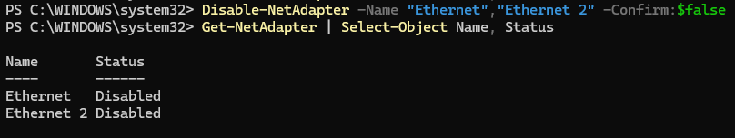
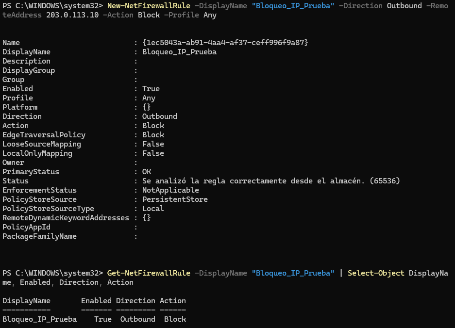
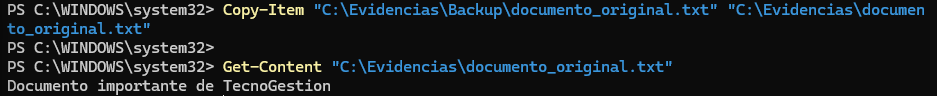
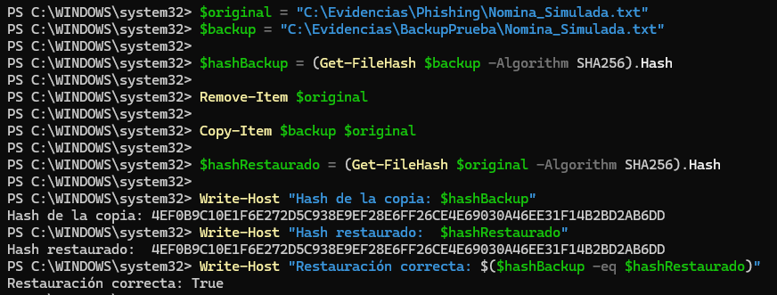

# 4. RESPUESTA Y RECUPERACIÓN

**Estado:** procedimiento desarrollado y tres evidencias prácticas de laboratorio documentadas.

## 4.1. Procedimiento de actuación

Una vez detectado el incidente en Daniel Company, debemos actuar rápidamente para detener el ataque y recuperar los sistemas afectados.

Seguiremos estas fases:

| Fase | Actuación |
|---|---|
| 1. Aislamiento | Desconectar de la red los equipos infectados para evitar que el ataque se propague. |
| 2. Bloqueo de conexiones | Bloquear las IP y dominios maliciosos mediante el firewall. |
| 3. Revocación de credenciales | Cambiar las contraseñas comprometidas y cerrar las sesiones sospechosas. |
| 4. Eliminación de la amenaza | Eliminar el malware y sus mecanismos de persistencia o reinstalar los equipos afectados. |
| 5. Recuperación | Restaurar archivos y sistemas utilizando copias de seguridad seguras. |
| 6. Prevención | Aplicar mejoras de seguridad para evitar nuevos ataques. |

Antes de eliminar el malware, debemos conservar las evidencias necesarias para la investigación.

### Cómo decidir el orden de actuación

Primero comprobaremos qué equipos presentan señales claras de infección. El equipo donde se ejecutó el archivo se tratará como prioritario. También revisaremos los servicios compartidos y las cuentas relacionadas.

La actuación debe equilibrar dos necesidades: **detener el ataque** y **conservar información útil para investigarlo**. No restauraremos todos los sistemas a la vez sin comprobar antes que la amenaza está controlada.

## 4.2. Aislamiento de los equipos afectados

El primer paso será aislar los ordenadores sospechosos para impedir que el atacante siga comunicándose con ellos.

Para ello:

- Desconectaremos los equipos de la red.
- Evitaremos que accedan a carpetas compartidas.
- Informaremos al departamento de informática.
- Conservaremos los registros y las evidencias.

No apagaremos los equipos sin valorar antes si podemos perder información importante para la investigación.

### Qué haremos en la práctica

En una empresa real, el aislamiento puede hacerse desconectando la red del equipo o utilizando funciones de seguridad gestionadas por informática. En nuestro laboratorio comprobaremos que la máquina virtual deja de comunicarse con la red cuando aplicamos el aislamiento.

Antes de efectuar cambios guardaremos las evidencias necesarias y anotaremos la hora. Después verificaremos el estado de la conexión. Esto nos permitirá demostrar no solo la acción, sino también su resultado.

## 4.3. Bloqueo de conexiones maliciosas

Utilizaremos el firewall para bloquear las comunicaciones con direcciones IP y dominios identificados como maliciosos.

También revisaremos las conexiones activas para comprobar si continúa existiendo actividad sospechosa.

En las prácticas utilizaremos el Firewall de Windows y PowerShell en una máquina virtual.

### Comprobación del bloqueo

Primero identificaremos con evidencias la conexión que queremos impedir. Después aplicaremos una regla de prueba en el firewall y verificaremos que produce el efecto esperado.

No bloquearemos direcciones al azar en equipos de producción: podríamos interrumpir servicios legítimos. En el laboratorio utilizaremos una dirección o comunicación controlada para comprobar las reglas de manera segura.

## 4.4. Revocación de credenciales comprometidas

Si sospechamos que el atacante ha conseguido contraseñas, aplicaremos las siguientes medidas:

- Cambiar las contraseñas comprometidas.
- Cerrar las sesiones sospechosas.
- Revocar los accesos que puedan estar comprometidos.
- Activar la autenticación multifactor (MFA).
- Revisar los permisos de los usuarios.

### Por qué no basta con cambiar una contraseña

Un atacante puede mantener sesiones abiertas o haber conseguido permisos adicionales. Por eso, además de modificar contraseñas, se revisarán sesiones, métodos de acceso, permisos y cuentas que hayan podido resultar comprometidas.

Los cambios se realizarán desde un equipo confiable, evitando introducir las credenciales nuevas en un ordenador que todavía pueda estar infectado.

## 4.5. Eliminación y recuperación

Una vez conservadas las evidencias necesarias y contenido el ataque, procederemos a eliminar la amenaza.

Para ello:

1. Identificaremos los archivos y procesos maliciosos.
2. Eliminaremos el malware o reinstalaremos los sistemas cuando sea necesario.
3. Instalaremos las actualizaciones de seguridad.
4. Restauraremos la información desde copias de seguridad verificadas.
5. Comprobaremos que los equipos funcionan correctamente antes de volver a conectarlos a la red.

La recuperación se realizará de forma controlada para evitar que el incidente vuelva a producirse.

### Comprobaciones antes de volver a trabajar

Después de limpiar o reconstruir un equipo, comprobaremos que se encuentra actualizado, que el antivirus funciona, que no quedan alertas sin resolver y que solo tiene los permisos necesarios.

También revisaremos si las copias de seguridad son anteriores a la infección y si contienen los datos necesarios. Los servicios esenciales se recuperarán por prioridad y se supervisarán por si aparecen nuevas alertas.

**Ejemplo:** aunque dirección solicite abrir inmediatamente el servidor de archivos, primero debemos verificar que el sistema es seguro para evitar una reinfección.

## 4.6. Ciberresiliencia

La ciberresiliencia es la capacidad de una empresa para prepararse, resistir, recuperarse y mejorar después de un incidente de seguridad.

Se basa en cuatro principios:

| Principio | Aplicación en la empresa |
|---|---|
| **Anticipación** | Formar empleados, actualizar equipos y realizar copias de seguridad. |
| **Resistencia** | Utilizar antivirus, firewall, MFA y control de accesos para limitar el ataque. |
| **Recuperación** | Restaurar los sistemas y servicios de forma segura. |
| **Evolución** | Analizar lo ocurrido y mejorar las medidas de seguridad. |

### Aplicación práctica de la ciberresiliencia

En este caso, **anticipación** significa preparar normas y copias antes del ataque; **resistencia** consiste en limitar el acceso del malware a otros equipos; **recuperación** será restaurar los sistemas de forma comprobada; y **evolución** será revisar por qué el correo llegó al empleado y qué controles deben mejorarse.

Al cerrar el incidente documentaremos las medidas que funcionaron y las que deben corregirse.


---

**Prácticas realizadas en laboratorio:** aislamiento temporal de interfaces de red, creación y comprobación de una regla de firewall, y restauración de un archivo de prueba. No se ha documentado una eliminación real de malware ni una prueba de tráfico bloqueado.

## Evidencias prácticas realizadas en el laboratorio

Las siguientes pruebas se realizaron en máquinas de laboratorio. Las capturas documentan los resultados observados; **no demuestran que se ejecutara malware real ni confirman una fuga de datos**.

### Aislamiento de la máquina virtual

**Herramienta o comando:** `Disable-NetAdapter`.

**Resultado:** Se deshabilitaron Ethernet y Ethernet 2 y se comprobó el estado Disabled. Se reactivaron para continuar el laboratorio.



*Evidencia: [P4_01_Aislamiento.png](../evidencias/P4_01_Aislamiento.png)*.

### Regla de bloqueo de IP

**Herramienta o comando:** `New-NetFirewallRule`.

**Resultado:** Se configuró una regla saliente activa para bloquear 203.0.113.10, una IP reservada para documentación. Se verificó la regla, no una conexión bloqueada real.



*Evidencia: [P4_02_BloqueoFirewall.png](../evidencias/P4_02_BloqueoFirewall.png)*.

### Restauración de archivo desde una copia

**Herramienta o comando:** `Copy-Item y Get-Content`.

**Resultado:** Se restauró el documento de prueba y se comprobó su contenido. Es una simulación simple de recuperación.



*Evidencia: [P4_03_Recuperacion.png](../evidencias/P4_03_Recuperacion.png)*.


## Revisión para la entrega

Las tres capturas ya están incorporadas. Las medidas de erradicación y revocación de credenciales se explican como procedimiento propuesto, no como actuaciones realizadas.

## 4.7. Práctica adicional: restauración verificada mediante SHA-256

**Objetivo:** demostrar que se puede recuperar un archivo desde una copia y comprobar que la restauración conserva su contenido.

**Entorno:** PowerShell de Windows, con un archivo de texto ficticio creado anteriormente. No se han utilizado datos reales de clientes.

**Fase 1: crear y comprobar la copia.**

```powershell
New-Item -Path "C:\Evidencias\BackupPrueba" -ItemType Directory -Force
Copy-Item "C:\Evidencias\Phishing\Nomina_Simulada.txt" "C:\Evidencias\BackupPrueba\Nomina_Simulada.txt"
Get-FileHash "C:\Evidencias\Phishing\Nomina_Simulada.txt" -Algorithm SHA256
Get-FileHash "C:\Evidencias\BackupPrueba\Nomina_Simulada.txt" -Algorithm SHA256
```

**Resultado:** ambos archivos mostraron el mismo SHA-256.

**Fase 2: simular pérdida, restaurar y verificar.**

```powershell
$original = "C:\Evidencias\Phishing\Nomina_Simulada.txt"
$backup = "C:\Evidencias\BackupPrueba\Nomina_Simulada.txt"
$hashBackup = (Get-FileHash $backup -Algorithm SHA256).Hash
Remove-Item $original
Copy-Item $backup $original
$hashRestaurado = (Get-FileHash $original -Algorithm SHA256).Hash
Write-Host "Restauración correcta: $($hashBackup -eq $hashRestaurado)"
```

**Resultado observado:** `Restauración correcta: True`. Los hashes del archivo copiado y restaurado coincidieron, lo que demuestra la integridad de esa restauración de prueba.

**Captura:** `P4_04_VerificacionRecuperacion.png`.



**Relación con el incidente:** tras contener y eliminar una amenaza, la empresa debe restaurar copias verificadas. Este ejercicio únicamente demuestra la recuperación de **un archivo inocuo**, no la restauración completa de un sistema infectado.

## 4.9. Conclusión

La respuesta y recuperación permiten detener el ataque, eliminar las amenazas y recuperar el funcionamiento de la empresa.

En Daniel Company aplicaremos medidas de aislamiento, bloqueo de conexiones, protección de credenciales y restauración de sistemas.

Además, utilizaremos los principios de ciberresiliencia para reducir las consecuencias de futuros incidentes.
